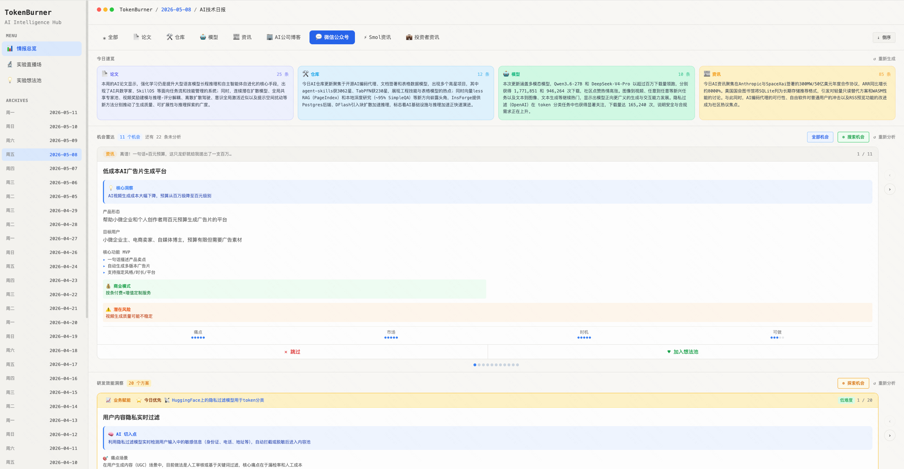
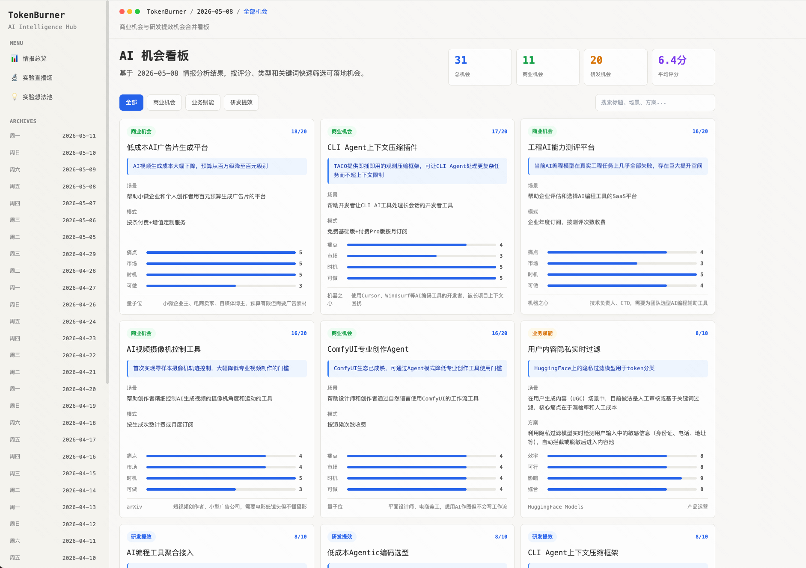
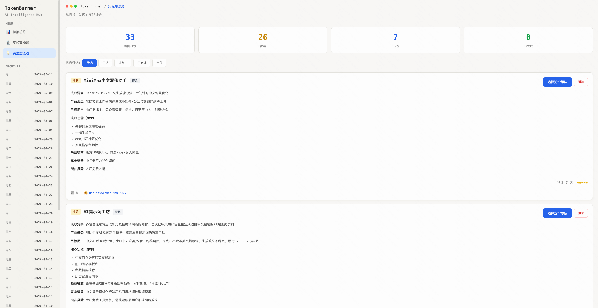
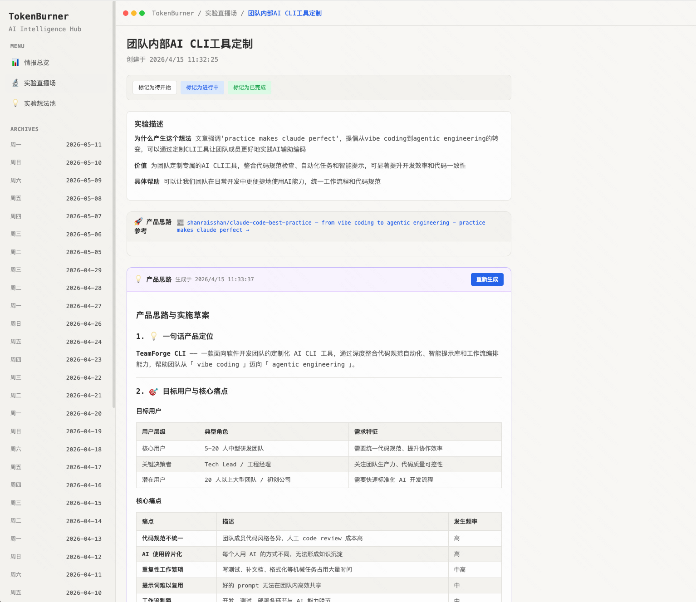

# TokenBurner

<p align="center">
  <strong>AI-native intelligence workspace for developers, researchers, builders, and investors.</strong>
</p>

<p align="center">
  <a href="#中文">中文</a> · <a href="#english">English</a>
</p>

<details open>
<summary id="中文"><strong>中文</strong></summary>

## SignalForge 是什么

SignalForge 是一个面向 AI 时代的情报信息处理工作台。它每天从论文、开源项目、模型平台、AI 公司博客、技术 Newsletter、中文科技媒体和投资者资讯中抓取最新的AI资讯情报内容，再用 LLM 生成结构化简报、速读摘要、商业机会分析和研发效能洞察。

它适合这些场景：

- 每天追踪 AI / 工程 / 产品 / 投资领域的关键信号
- 把分散的信息源收敛成一份可读、可检索、可复盘的日报
- 从新闻、论文和开源趋势中发现产品机会、创业线索和研发工具改进点
- 为团队建立自己的内部 AI intelligence hub

## 项目亮点

### 多源情报采集

内置 60+ 数据源，覆盖从一手技术信号到中文商业语境的多种内容形态：

- 论文：arXiv `cs.CL` / `cs.AI` / `cs.LG`、HuggingFace Daily Papers
- 开源：GitHub Trending、HuggingFace Trending Models
- 官方博客：OpenAI、Google DeepMind、Google AI、Meta Engineering、Anthropic、Cohere
- Newsletter：Smol AI News、Ben's Bites、Latent Space、The AI Valley
- 技术博客：Simon Willison、Gwern、Interconnects、antirez、matklad 等
- 中文媒体：机器之心、量子位、晚点 LatePost、虎嗅、Founder Park、极客公园、深思圈等
- 投资者资讯：All-In Podcast、AI investor feeds、VC / market news feeds

### AI 结构化简报

TokenBurner 不只是聚合链接，而是把内容加工成可以直接阅读和决策的格式：

- 每日简报：按论文、项目、模型、新闻、博客等类别组织
- 速读摘要：为单篇内容生成核心内容、关键要点和一句话洞察
- 分类 digest：对同类内容做聚合总结，减少重复阅读
- 中文简报：适合中文团队内部流转和复盘

### 机会雷达

系统会从当天信号中提取两类更高价值的判断：

- 商业机会分析：发现市场空白、产品切入点、创业 idea 和潜在需求
- 研发效能分析：识别工程团队可以采用的工具、流程优化和自动化机会

### 实验与想法管理

除了“看信息”，TokenBurner 也提供把信息转化为行动的入口：

- 想法收集与 AI 补全
- 实验状态追踪
- 假设、过程和结果统一管理
- 支持从每日情报沉淀长期项目线索

### 开发者友好的本地优先架构

- 一条命令启动前后端：`./start.sh`
- 一条命令跑完整日报流水线：`pnpm daily`
- FastAPI 后端 + React/Vite 前端
- 文件型 JSON 存储，无需先配置数据库
- 统一 LLM client，可按任务路由到 Kimi / DeepSeek
- 配置化数据源，新增 RSS 订阅不需要改业务代码
- 附带 Remotion 视频生成能力，可把 AI 情报渲染成短视频素材

## 界面与能力

- 最新日报：自动跳转到最近可用日期的 briefing
- 单篇速读：对每条内容展示更短的阅读版本
- 机会面板：集中查看商业机会和研发效能机会
- 实验页：管理 idea、实验进展和复盘记录
- API 文档：启动后端后访问 `http://localhost:8001/docs`
- 视频输出：通过 Remotion 生成 AI intelligence short

## 效果图

### 情报总览



### AI 机会看板



### 实验想法池



### 实验详情与产品思路



## 技术栈

| 模块 | 技术 |
| --- | --- |
| Frontend | React 18, Vite, TailwindCSS, React Router |
| Backend | FastAPI, Python 3.11+, uvicorn |
| AI / LLM | Kimi / Moonshot, DeepSeek, unified `llm_client.py` |
| Storage | File-based JSON，默认不依赖数据库 |
| Collection | arXiv API, GitHub scraper, HuggingFace API, RSS feeds |
| Video | Remotion 4 |

## 项目结构

```text
token-burn/
├── backend/
│   ├── routers/                  # FastAPI routes
│   ├── services/
│   │   ├── collector.py          # 采集流水线编排
│   │   ├── llm_client.py         # 统一 LLM client
│   │   ├── rss_fetcher.py        # RSS / Newsletter / WeChat feed 解析
│   │   ├── arxiv_fetcher.py      # arXiv API
│   │   ├── github_fetcher.py     # GitHub Trending
│   │   ├── briefing_generator.py # 每日简报生成
│   │   └── chinese_briefer.py    # 中文简报生成
│   ├── config/collector.yaml     # 数据源配置
│   ├── docs/daily-briefings/     # 生成的 Markdown 简报
│   └── cli.py                    # CLI 入口
├── frontend/                     # React + Vite + TailwindCSS dashboard
├── src/                          # Remotion video composition
├── data/
│   ├── content/                  # 原始采集内容
│   ├── briefings/                # 结构化日报
│   ├── quick_reads/              # 单篇速读缓存
│   └── opportunities/            # 机会分析结果
└── start.sh                      # 本地一键启动脚本
```

## 数据流

```text
Sources
  -> Fetch & normalize
  -> Store as JSON
  -> LLM quick-read summaries
  -> Daily briefing
  -> Opportunity / R&D analysis
  -> Frontend dashboard + optional video render
```

## 快速开始

### 1. 安装依赖

```bash
# Backend
cd backend
python -m venv venv
source venv/bin/activate
pip install -r requirements.txt

# Frontend
cd ../frontend
pnpm install

# Root / Remotion scripts
cd ..
npm install
```

### 2. 配置环境变量

```bash
cp .env.example .env
```

填写需要的 key：

```bash
KIMI_API_KEY=your_kimi_api_key_here
DEEPSEEK_API_KEY=your_deepseek_api_key_here
```

- Kimi / Moonshot: https://platform.moonshot.cn
- DeepSeek: https://platform.deepseek.com

### 3. 启动应用

```bash
./start.sh
```

默认地址：

- Frontend: `http://localhost:5174`
- Backend: `http://localhost:8001`
- API Docs: `http://localhost:8001/docs`

也可以分开启动：

```bash
pnpm dev:frontend
pnpm dev:backend
```

注意：`./start.sh` 使用后端端口 `8001`；根目录 `pnpm dev:backend` 当前脚本使用端口 `8000`。

### 4. 运行每日流水线

```bash
pnpm daily       # collect -> quick reads -> briefing
pnpm collect     # 只采集
pnpm briefing    # 基于已有数据生成简报
pnpm stats       # 查看采集统计
pnpm refetch     # 重新抓取指定日期，需传 CLI 参数时可进入 backend 执行
```

更多 CLI：

```bash
cd backend
source venv/bin/activate

python cli.py daily [YYYY-MM-DD]
python cli.py collect --date YYYY-MM-DD
python cli.py briefing --date YYYY-MM-DD
python cli.py summarize --date YYYY-MM-DD
python cli.py quick-reads --date YYYY-MM-DD
python cli.py chinese --date YYYY-MM-DD
python cli.py stats
python cli.py refetch YYYY-MM-DD
```

## 生成视频

项目根目录包含 Remotion composition，可以把情报内容渲染为短视频：

```bash
npm run dev      # 打开 Remotion Studio
npm run render   # 输出 out/ai-intelligence-short.mp4
```

## 添加数据源

编辑 `backend/config/collector.yaml`，在 `sources.rss.subscriptions` 下新增订阅：

```yaml
- name: "My Blog"
  type: "direct"
  source_type: "blog"
  url: "https://example.com/feed.xml"
  category: ["tech", "ai"]
  fetchInterval: 3600
```

常用 `source_type`：

- `blog`：技术博客或公司博客
- `wechat`：中文公众号镜像源
- `hackernews`：HN / 技术日报类来源
- `smolai`：可拆解 issue topics 的 AI 日报
- `investor`：投资者和市场资讯
- `news`：新闻聚合源

## 开源前建议

- 确认 `.env` 没有被提交，公开仓库只保留 `.env.example`
- 根据你的开源策略补充 `LICENSE`
- 如不希望公开历史数据，可清理或抽样保留 `data/` 下的生成内容
- 检查 `backend/config/collector.yaml` 中是否包含私有 RSS 或内部来源

## Roadmap

- 更灵活的模型 provider 配置
- 数据源健康检查和失败重试面板
- 多语言 briefing 输出
- 团队协作与评论能力
- 一键发布到 newsletter / social / knowledge base

</details>

<details>
<summary id="english"><strong>English</strong></summary>

## What Is TokenBurner

TokenBurner is an AI-native intelligence workspace for the AI era. It collects papers, open-source projects, model updates, AI lab blogs, technical newsletters, Chinese tech media, and investor feeds every day, then turns them into structured briefings, quick-read summaries, opportunity analysis, and R&D productivity insights.

It is useful for:

- Tracking daily signals across AI, engineering, product, and investing
- Turning scattered sources into readable and reviewable daily briefings
- Discovering product opportunities, startup ideas, and engineering workflow improvements
- Building an internal AI intelligence hub for a team

## Highlights

### Multi-source Intelligence Collection

TokenBurner ships with 60+ configured sources across first-party technical signals and market context:

- Papers: arXiv `cs.CL` / `cs.AI` / `cs.LG`, HuggingFace Daily Papers
- Open source: GitHub Trending, HuggingFace Trending Models
- Official blogs: OpenAI, Google DeepMind, Google AI, Meta Engineering, Anthropic, Cohere
- Newsletters: Smol AI News, Ben's Bites, Latent Space, The AI Valley
- Engineering blogs: Simon Willison, Gwern, Interconnects, antirez, matklad, and more
- Chinese media: 机器之心, 量子位, LatePost, 虎嗅, Founder Park, GeekPark, 深思圈, and more
- Investor feeds: All-In Podcast, AI investor feeds, VC / market news feeds

### AI-generated Structured Briefings

TokenBurner is not a link aggregator. It processes raw items into formats that are easier to read and act on:

- Daily briefings organized by papers, repos, models, news, blogs, and more
- Per-item quick reads with core summary, key points, and one-line insight
- Category-level digests to reduce repeated reading
- Chinese-language briefings for Chinese-speaking teams

### Opportunity Radar

The system extracts two higher-level views from each day's signals:

- Commercial opportunity analysis: market gaps, product entry points, startup ideas, and emerging demand
- R&D efficiency analysis: tools, workflow improvements, and automation opportunities for engineering teams

### Experiments And Ideas Management

TokenBurner also helps turn information into action:

- Idea capture with AI enrichment
- Experiment status tracking
- Hypothesis, process, and outcome management
- Long-term project leads derived from daily intelligence

### Developer-first Local Architecture

- Start frontend and backend with `./start.sh`
- Run the full daily pipeline with `pnpm daily`
- FastAPI backend + React/Vite frontend
- File-based JSON storage, no database setup required by default
- Unified LLM client with task-level routing to Kimi / DeepSeek
- Config-driven sources, so adding RSS feeds does not require business logic changes
- Remotion support for rendering AI intelligence into short-form video assets

## Product Surface

- Latest briefing: automatically redirects to the latest available date
- Quick reads: concise summaries for individual items
- Opportunity dashboard: commercial and R&D productivity opportunities in one place
- Experiments pages: manage ideas, experiment progress, and retrospectives
- API docs: available at `http://localhost:8001/docs` after backend startup
- Video output: Remotion-based AI intelligence short rendering

## Screenshots

### Intelligence Briefing


### AI Opportunity Dashboard


### Experiment Idea Pool


### Experiment Detail And Product Thinking


## Tech Stack

| Layer | Stack |
| --- | --- |
| Frontend | React 18, Vite, TailwindCSS, React Router |
| Backend | FastAPI, Python 3.11+, uvicorn |
| AI / LLM | Kimi / Moonshot, DeepSeek, unified `llm_client.py` |
| Storage | File-based JSON, no database required by default |
| Collection | arXiv API, GitHub scraper, HuggingFace API, RSS feeds |
| Video | Remotion 4 |

## Architecture

```text
token-burn/
├── backend/
│   ├── routers/                  # FastAPI routes
│   ├── services/
│   │   ├── collector.py          # Collection pipeline orchestration
│   │   ├── llm_client.py         # Unified LLM client
│   │   ├── rss_fetcher.py        # RSS / newsletter / WeChat feed parsing
│   │   ├── arxiv_fetcher.py      # arXiv API
│   │   ├── github_fetcher.py     # GitHub Trending
│   │   ├── briefing_generator.py # Daily briefing generation
│   │   └── chinese_briefer.py    # Chinese briefing generation
│   ├── config/collector.yaml     # Source configuration
│   ├── docs/daily-briefings/     # Generated Markdown briefings
│   └── cli.py                    # CLI entry point
├── frontend/                     # React + Vite + TailwindCSS dashboard
├── src/                          # Remotion video composition
├── data/
│   ├── content/                  # Raw collected items
│   ├── briefings/                # Structured briefings
│   ├── quick_reads/              # Per-item quick-read cache
│   └── opportunities/            # Opportunity analysis outputs
└── start.sh                      # Local one-command startup script
```

## Data Flow

```text
Sources
  -> Fetch & normalize
  -> Store as JSON
  -> LLM quick-read summaries
  -> Daily briefing
  -> Opportunity / R&D analysis
  -> Frontend dashboard + optional video render
```

## Quick Start

### 1. Install Dependencies

```bash
# Backend
cd backend
python -m venv venv
source venv/bin/activate
pip install -r requirements.txt

# Frontend
cd ../frontend
pnpm install

# Root / Remotion scripts
cd ..
npm install
```

### 2. Configure Environment

```bash
cp .env.example .env
```

Fill in your API keys:

```bash
KIMI_API_KEY=your_kimi_api_key_here
DEEPSEEK_API_KEY=your_deepseek_api_key_here
```

- Kimi / Moonshot: https://platform.moonshot.cn
- DeepSeek: https://platform.deepseek.com

### 3. Start The App

```bash
./start.sh
```

Default URLs:

- Frontend: `http://localhost:5174`
- Backend: `http://localhost:8001`
- API Docs: `http://localhost:8001/docs`

You can also start services separately:

```bash
pnpm dev:frontend
pnpm dev:backend
```

Note: `./start.sh` uses backend port `8001`; the current root `pnpm dev:backend` script uses port `8000`.

### 4. Run The Daily Pipeline

```bash
pnpm daily       # collect -> quick reads -> briefing
pnpm collect     # collection only
pnpm briefing    # generate briefing from existing data
pnpm stats       # collection statistics
pnpm refetch     # refetch a target date when called through backend CLI
```

More CLI commands:

```bash
cd backend
source venv/bin/activate

python cli.py daily [YYYY-MM-DD]
python cli.py collect --date YYYY-MM-DD
python cli.py briefing --date YYYY-MM-DD
python cli.py summarize --date YYYY-MM-DD
python cli.py quick-reads --date YYYY-MM-DD
python cli.py chinese --date YYYY-MM-DD
python cli.py stats
python cli.py refetch YYYY-MM-DD
```

## Render Video

The root project includes a Remotion composition for rendering intelligence content into short-form video:

```bash
npm run dev      # Open Remotion Studio
npm run render   # Output out/ai-intelligence-short.mp4
```

## Add A Source

Edit `backend/config/collector.yaml` and add a subscription under `sources.rss.subscriptions`:

```yaml
- name: "My Blog"
  type: "direct"
  source_type: "blog"
  url: "https://example.com/feed.xml"
  category: ["tech", "ai"]
  fetchInterval: 3600
```

Common `source_type` values:

- `blog`: engineering or company blogs
- `wechat`: mirrored Chinese WeChat sources
- `hackernews`: HN or technical daily feeds
- `smolai`: AI daily issues that can be expanded into topics
- `investor`: investor and market feeds
- `news`: general news aggregators

## Before Open-sourcing

- Make sure `.env` is not committed and only `.env.example` is public
- Add a `LICENSE` according to your open-source strategy
- Clean or sample generated files under `data/` if you do not want to publish historical data
- Check `backend/config/collector.yaml` for private RSS feeds or internal sources

## Roadmap

- More flexible model provider configuration
- Source health checks and retry dashboard
- Multi-language briefing output
- Team collaboration and comments
- One-click publishing to newsletter / social / knowledge base

</details>
