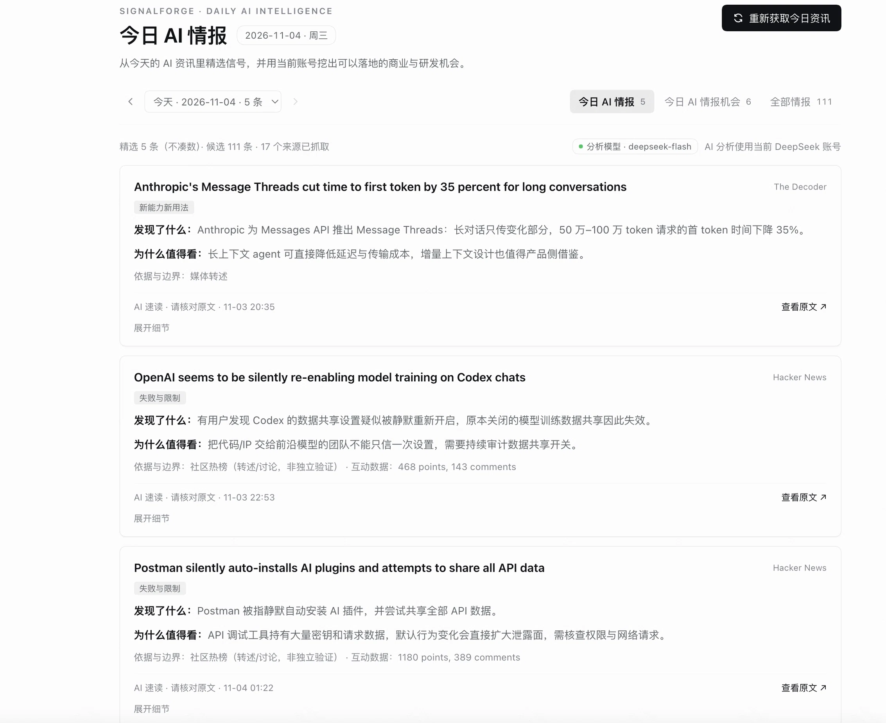
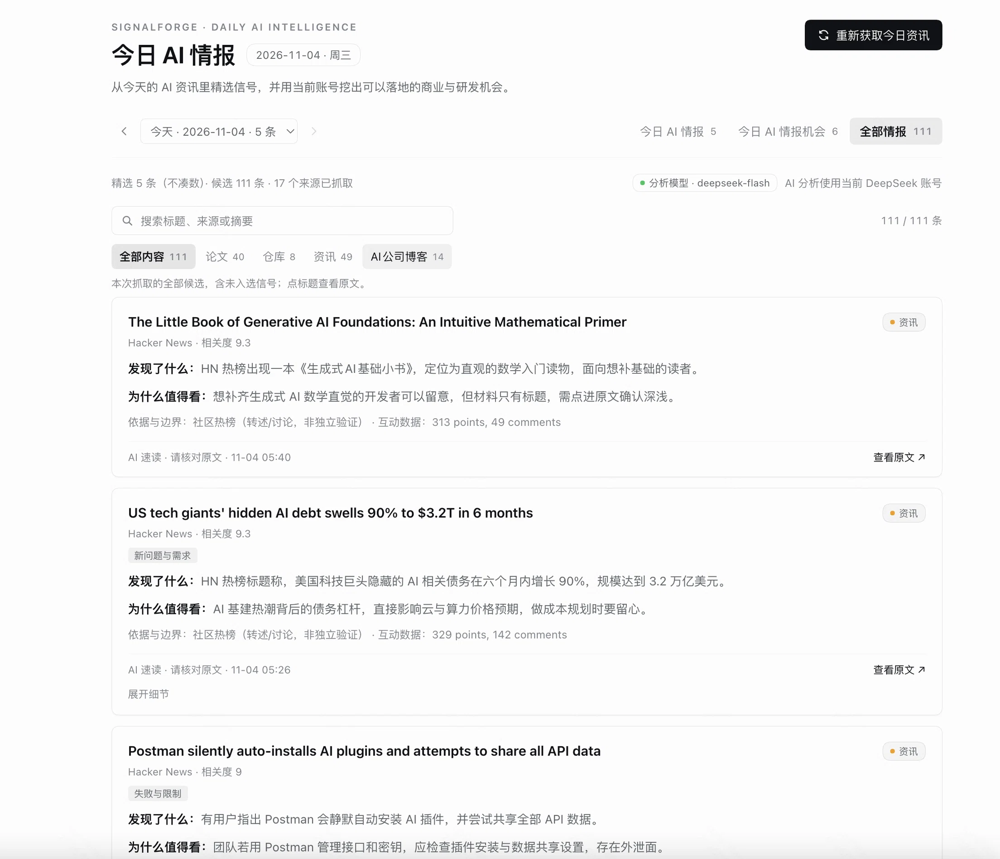
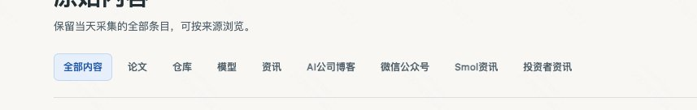

# SignalForge · 今日 AI 情报

> 在 DeepSeek Harness 里点一次，抓取今天的 AI 资讯，用你当前登录的 DeepSeek 账号精选信号、生成商业与研发机会，并把所有候选写成中文速读。

这是一个社区插件，不是 DeepSeek 官方项目。适配 DeepSeek Harness `0.2.1-rc.5` / `0.2.x`，无需额外 API Key。

<p align="center">
  
</p>

## 它能做什么

- **今日 AI 情报**：从 28 个来源抓候选，最多精选 5 条，每条写清「发现了什么 / 为什么值得看 / 依据与边界」，并保留原文链接。
- **今日 AI 情报机会**：从当天信号出发，生成 3 个商业机会 + 3 个研发提效机会，包含触发点、产品形态、目标用户、MVP、风险或集成方式。
- **全部情报**：当天抓到的全部候选都保留，每条都有中文速读，可按标题/来源/摘要搜索，按论文、仓库、模型、资讯、AI公司博客等分类筛选。
- **继续对话**：每张卡片底部有「继续对话」，点击会把标题、链接、来源、中文速读、依据与关键信息填进一个新的 Harness 对话输入框，直接接着问。
- **论文精读**：论文卡片多一个「精读论文」按钮；顶部还有一个折叠的「论文精读」面板，可以粘贴情报之外的 arXiv / DOI / PDF 链接或标题 + 摘要。
- **按天保存**：每天一个 digest，日期下拉回看；没有信号的日期不出现。
- **用当前账号分析**：不配置 `.env`，不保存 API Key，直接走 Harness 当前默认模型（本机验证为 `deepseek-account / deepseek-flash`）。

## 界面

### 今日 AI 情报

精选卡片：中文速读、五类标签、依据与边界、原文链接、可展开细节。


### 全部情报

111 条候选全部可见，未入选的也在里面；每张卡片右上角是分类标签，正文是中文「发现了什么 / 为什么值得看」。



### 分类筛选

按当天实际出现的分类筛选，例如论文、仓库、资讯、AI公司博客；没有对应内容的分类不会出现。



## 安装

### 方式一：GitHub 源码（现在就能用）

```bash
dsh plugin --profile desktop add "github:sunstdot/signalforge-dsh"
```

插件没有构建步骤、没有运行时依赖，直接从 GitHub 安装即可。

### 方式二：GitHub Release 包（推荐，版本固定）

从 [Releases](https://github.com/sunstdot/signalforge-dsh/releases) 下载 `dsh-signalforge-<version>.tgz` 和 `SHA256SUMS`，校验后安装：

```bash
shasum -a 256 -c SHA256SUMS
dsh plugin --profile desktop add "$PWD/dsh-signalforge-0.1.4.tgz"
```

Linux 用 `sha256sum -c SHA256SUMS`。这种分发方式不依赖 npm，也不会在安装时执行构建。

### 方式三：npm（可选）

npm 不是 DSH 插件的必要条件，只是安装命令更短。如果包已经发布到公共 npm：

```bash
dsh plugin --profile desktop add dsh-signalforge
```

### 安装后

`dsh plugin add` 会安装包、写入当前 profile，并自动选中 bundle。**刷新一次 Harness 页面**（或重启应用），左侧出现雷达图标 **今日 AI 情报**。

如果 `dsh` 不在 `PATH` 里，用应用自带的启动器（macOS）：

```bash
/Applications/DeepSeek\ Harness.app/Contents/Resources/runtime/cli/bin/dsh
```

## 使用

1. 左侧打开 **今日 AI 情报**。
2. 点右上角 **获取今日资讯**。
3. 等待约 **2–3 分钟**：
   - 抓取 28 个来源（其中 15 个官方博客）；
   - AI 精选最多 5 条信号；
   - 生成商业 + 研发机会；
   - 为全部候选写中文速读；
   - 保存当天结果。
4. 在 **今日 AI 情报 / 今日 AI 情报机会 / 全部情报** 三个标签间切换。
5. 想深挖某一条时，点卡片底部的 **继续对话**：会打开新对话，并把这条情报的标题、URL、来源、中文速读、依据和关键信息填进输入框。
6. 读论文时，论文卡片底部点 **精读论文**；情报之外的论文，点页面上方的 **论文精读** 面板，粘贴链接/标题摘要即可。
7. 用日期下拉回看历史。获取只对当天生效；历史日期只读。

一次完整生成会调用多次当前账号的模型。面板会显示阶段和批次进度。对于只有英文摘要的历史日期，打开后点 **补全中文速读**，只会补速读，不重跑精选和机会，避免重复消耗 token。

## 数据来源

每个来源独立超时、独立失败；单个源挂掉不会影响当天结果。

| 类型 | 来源 |
| --- | --- |
| 社区 | Hacker News 热榜、Hacker News Algolia 近 48 小时搜索 |
| 论文 | arXiv `cs.AI` / `cs.CL` / `cs.LG`、Hugging Face Daily Papers |
| 开源 | GitHub Trending（AI 关键词过滤） |
| 官方博客 | OpenAI、Google DeepMind、Google AI、Google Research、Hugging Face、Anthropic News、Anthropic Engineering、Cognition、Meta AI、NVIDIA Developer、Apple Machine Learning、LangChain、Cohere、Cloudflare AI、AWS Machine Learning |
| 媒体 / Newsletter | The Decoder、TechCrunch AI、Latent Space、Smol AI News、Simon Willison、One Useful Thing、Import AI、Interconnects |

官方博客使用 14 天窗口（其他来源 48 小时），避免 Anthropic、Cognition 这类周更博客在安静的一天直接消失。

## 分类

「全部情报」使用这些分类：

- **论文**：arXiv、Hugging Face Daily Papers
- **仓库**：GitHub Trending
- **模型**：模型来源（有对应内容时出现）
- **资讯**：Hacker News、媒体、Newsletter、个人博客
- **AI公司博客**：OpenAI、Google DeepMind、Google AI、Google Research、Hugging Face、Anthropic、Cognition、Meta AI、NVIDIA、Apple ML、LangChain、Cohere、Cloudflare、AWS ML
- **微信公众号资讯**：微信公众号来源（有对应内容时出现）
- **Smol 资讯**：Smol AI News
- **投资者资讯**：投资者来源（有对应内容时出现）

## 数据与隐私

- 每天的完整结果保存在 `$DSH_HOME/signalforge/digests/YYYY-MM-DD.json`，索引在 `$DSH_HOME/signalforge/index.json`。
- 插件不读 `.env`、不保存 API Key、不走 SignalForge 的 FastAPI 后端。
- 分析通过 Harness 的 LLM 服务使用当前账号和默认模型；候选标题与摘要会发送给该模型。
- 抓取只访问上面列出的公开来源；没有埋点、没有遥测。
- Host API 位于本机 Harness Web 服务的 `/signalforge/api`，没有额外鉴权（与其他本机插件数据路由一致）；不要把 Harness 端口暴露到不可信网络。

## 配置

Bundle 默认值：

```yaml
- insert:
    - id: signalforge
      name: dsh-signalforge
      config:
        timezone: Asia/Shanghai
        maxSignals: 5
        lookbackHours: 48
```

在 profile 的 `cordis.patch.yml` 里可以覆盖：

```yaml
- id: signalforge
  name: dsh-signalforge
  config:
    timezone: Asia/Shanghai
    maxSignals: 8
    lookbackHours: 72
```

`maxSignals` 范围 1–8；`lookbackHours` 范围 6–168；也可以显式设置 `dataDir`。

## 开发

```bash
npm test          # 桩模型检查信号/机会与中文速读映射
npm run check     # 对全部 JS 文件执行 node --check
node scripts/probe.mjs              # 只跑抓取，检查来源覆盖
node scripts/test-client.mjs        # 客户端模块注册与首屏渲染
node scripts/test-chat.mjs          # 继续对话：文章信息与 startSession 调用
```

`node scripts/test-render-digest.mjs` 需要本地 `$DSH_HOME/signalforge` 里有真实 digest；`node scripts/backfill-items.mjs` 可以只补候选、不重跑模型。

目录：

```text
index.js                 Host：流水线、存储、/signalforge/api
client.js                Web 客户端：侧栏面板与三个标签
cordis.patch.yml         Bundle 默认配置
src/sources.js           28 个来源、HTML/RSS 采集、去重、排序、分类
src/analyze.js           信号/机会提示词 + 批量中文速读
src/paper-skill.js       paper-reading 技能：论文精读协议与输出契约
src/pipeline.js          完整任务与只补速读任务
src/store.js             每日 JSON + 索引
src/http.js              同源 JSON API
src/legacy.js            可选：导入旧 SignalForge 历史简报
```

发布步骤见 [PUBLISHING.md](PUBLISHING.md)。所有截图来自真实安装后的 Harness 页面，未合成 AI 回答。

## 已知边界

- 只支持获取当天；历史日期只读，可单独补中文速读。
- 没有定时任务；每天需要点一次。
- 第一期没有接入 X、Reddit、微信公众号公开账号（需要登录或稳定代理）；分类标签已预留。
- AI 输出是阅读辅助，不是事实核验。每张卡片都标注证据类型，请打开原文确认。
- 导入的历史日期速读按需生成，不会自动消耗 token。

## English

SignalForge brings daily AI intelligence into DeepSeek Harness. One click fetches today's AI sources, selects up to five signals, writes Chinese quick-reads for every candidate, and generates business and engineering opportunities — all through the signed-in DeepSeek account.

- Three tabs: selected signals, opportunities, and every candidate.
- Every card has **Discuss with AI**, which opens a new Harness conversation with the title, URL, Chinese quick-read, evidence, and details already in the composer.
- Paper cards add **Read paper**, which uses a registered `paper-reading` skill: classify the contribution, read out of order, separate assumptions, audit experiments, and decide adoption.
- A collapsible **Paper reader** panel accepts manual arXiv/DOI/PDF links or a title + abstract for papers outside the digest.
- 28 login-free sources, including 15 official AI company blogs; Chinese quick-reads; paper/repo/model/news/blog categories.
- One digest per day under `$DSH_HOME/signalforge`.

Install from source:

```bash
dsh plugin --profile desktop add "github:sunstdot/signalforge-dsh"
```

Or download the `.tgz` from Releases. npm is optional. Refresh the Harness page after installation and open **今日 AI 情报** in the sidebar. See [PUBLISHING.md](PUBLISHING.md) for release details.

## License

MIT — see [LICENSE](LICENSE).
